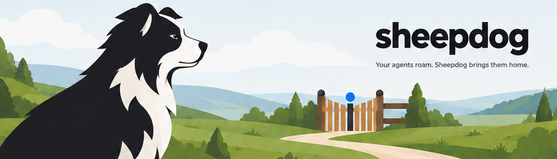
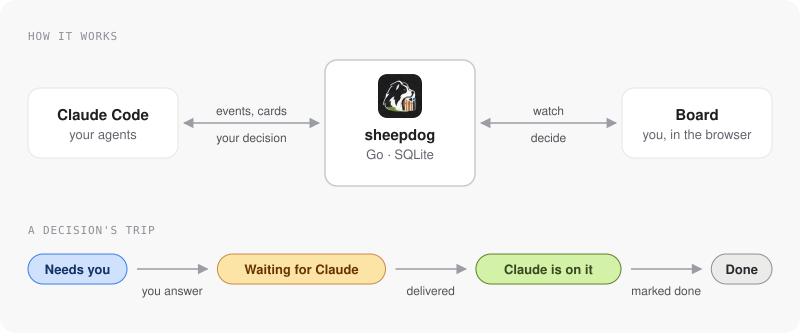

# sheepdog

Your agents roam. Sheepdog brings them home.

A small, self-hosted board that watches your AI coding agents and brings every decision to you.

<!-- diagram source: docs/diagrams/architecture.json -->


What it does:
- Watches your agents through Claude Code hooks: tasks, sub-agents, failed commands and a live feed.
- Shows review cards you answer in the browser (pick an option or write a reply).
- Delivers your decision back to the agent that asked, once, in the right folder.
- One static binary, SQLite storage, no frameworks, no CDN.
- Private by default: a folder allowlist, paths and names rewritten before storage, secrets redacted.

It watches and takes light edits (status, note, archive); it does not start, stop or control agents.

## Quick start

1. Install: `go install github.com/DalatHappyFarm/sheepdog/cmd/sheepdog@latest`.
2. Pick a token: `export SHEEPDOG_TOKEN=change-me`.
3. Start the server for your projects: `SHEEPDOG_ALLOW=~/work/alpha:~/work/beta sheepdog serve`.
4. Add the hook entries below to `~/.claude/settings.json`, with `SHEEPDOG_URL` and `SHEEPDOG_TOKEN` set in the environment Claude runs in.
5. Open `http://127.0.0.1:8787/?token=change-me` once.
6. Start Claude Code in one of those folders; the session appears on the board.

## Install

```sh
go install github.com/DalatHappyFarm/sheepdog/cmd/sheepdog@latest
```

Or build from a checkout: `go build -o bin/sheepdog ./cmd/sheepdog`.
The binary is static (Go, one dependency: `modernc.org/sqlite`, no cgo) and has the pages and brand images embedded.

## Run locally

```sh
SHEEPDOG_TOKEN=change-me sheepdog serve                    # http://127.0.0.1:8787
sheepdog serve --no-auth --db /tmp/board.db                # local dev only, no token
```

Open `http://127.0.0.1:8787/?token=change-me` once; the token moves into an HttpOnly SameSite=Strict cookie.
API clients send `Authorization: Bearer <token>`.
Options: `--db` (or `SHEEPDOG_DB`; default `~/.local/share/sheepdog/board.db`), `--host`, `--port`, `--allow DIR` (repeatable).
Events older than 30 days and anything beyond 200k rows are pruned on start and hourly.
The old `BOARD_TOKEN`, `BOARD_URL`, `BOARD_DB` and `BOARD_TOOL_EVENTS` names still work while the `SHEEPDOG_*` one is unset.

## Hooks

Add this to `~/.claude/settings.json` (merge with existing `hooks`; use the full path to the binary if it is not on `PATH`).
Set `SHEEPDOG_URL` and `SHEEPDOG_TOKEN` in the environment Claude runs in.
The hook command always exits 0 with no output (apart from decisions waiting for you), even if the server is down, and gives up after 1 s.

```json
{
  "hooks": {
    "SessionStart": [
      {
        "hooks": [
          {
            "type": "command",
            "command": "sheepdog hook",
            "timeout": 2
          }
        ]
      }
    ],
    "SessionEnd": [
      {
        "hooks": [
          {
            "type": "command",
            "command": "sheepdog hook",
            "timeout": 2
          }
        ]
      }
    ],
    "UserPromptSubmit": [
      {
        "hooks": [
          {
            "type": "command",
            "command": "sheepdog hook",
            "timeout": 2
          }
        ]
      }
    ],
    "PreToolUse": [
      {
        "matcher": "Agent|Task",
        "hooks": [
          {
            "type": "command",
            "command": "sheepdog hook",
            "timeout": 2
          }
        ]
      }
    ],
    "PostToolUse": [
      {
        "hooks": [
          {
            "type": "command",
            "command": "sheepdog hook",
            "timeout": 2
          }
        ]
      }
    ],
    "PostToolUseFailure": [
      {
        "hooks": [
          {
            "type": "command",
            "command": "sheepdog hook",
            "timeout": 2
          }
        ]
      }
    ],
    "SubagentStart": [
      {
        "hooks": [
          {
            "type": "command",
            "command": "sheepdog hook",
            "timeout": 2
          }
        ]
      }
    ],
    "SubagentStop": [
      {
        "hooks": [
          {
            "type": "command",
            "command": "sheepdog hook",
            "timeout": 2
          }
        ]
      }
    ],
    "Stop": [
      {
        "hooks": [
          {
            "type": "command",
            "command": "sheepdog hook",
            "timeout": 2
          }
        ]
      }
    ],
    "Notification": [
      {
        "hooks": [
          {
            "type": "command",
            "command": "sheepdog hook",
            "timeout": 2
          }
        ]
      }
    ]
  }
}
```

Ordinary tool calls (Bash, Edit, ...) are recorded once, on PostToolUse, as one compact line.
Set `SHEEPDOG_TOOL_EVENTS=0` on the server to skip them.
Tool output and file contents are never stored, except the last lines of a failed command (redacted).
Bash commands keep the first 200 characters after redaction (tokens, passwords, Authorization headers, AWS keys, URL passwords).

## How hooks map to the board

An event links to a task when its `cwd` is inside a task worktree (longest prefix wins); there is no guessing by project name.
The folders are compared in the rewritten form described under Privacy.
Events from a subagent link to that agent's task.

Exact (documented payload fields):
- SessionStart, SessionEnd, UserPromptSubmit (first 120 chars), Stop, Notification, PostToolUseFailure become events.
- PreToolUse for the `Agent` tool (`Task` in older versions) gives `description`, `subagent_type`, `model`, `tool_use_id`.
- PostToolUse for `Agent` gives `tool_response.status`, `agentId`, `totalTokens`, `totalToolUseCount`; the agent becomes done with tokens and tool uses.
- PostToolUseFailure for `Agent` marks the agent failed.
- SubagentStop (`agent_id`, `agent_type`) marks that agent done.
- A background agent (`status: async_launched`) stays running until its SubagentStop.

Best guess:
- SubagentStart has only `agent_id` and `agent_type`, no `tool_use_id`, so it adopts the oldest running placeholder row of the same session and `subagent_type` that PreToolUse created.
  Several parallel agents of the same type may swap names and models.
- `tool_response.agentId` is assumed to equal the hook `agent_id`; if not, the row is still closed by `tool_use_id`, but SubagentStop creates a second row.
- A session killed mid-run never sends SubagentStop, so its agent stays "running".
- Per-agent tool counts are the number of recorded PostToolUse events inside that agent.
  With `SHEEPDOG_TOOL_EVENTS=0` they stay 0 until the final Agent response reports the total.

## CLI

All commands talk to the server over HTTP (`SHEEPDOG_URL`, default `http://127.0.0.1:8787`; `SHEEPDOG_TOKEN`), so they work against a remote server.

```sh
sheepdog task T2 --title "Add login" --status testing --project alpha \
  --branch feat/x --worktree /abs/path --mr https://git.example.com/alpha/app/-/merge_requests/1 --note "tests green"
sheepdog agent <id> --task T2 --name "reviewer" --model sonnet --status running   # or done / failed
sheepdog brief T2 --file review.md --option 'merge|Approve and merge|ships it' --option 'hold|Hold' --primary merge --cwd /abs/path
sheepdog wait --cwd /abs/path       # blocks until you decide on the board, prints the decision
sheepdog done <decision-id>         # acknowledge it
sheepdog archive T2
```

Statuses: planned, analysing, building, review, testing, done, blocked.
`task` creates the task if the key is new, otherwise updates only the given fields, and prints the task as JSON.
`brief` posts a review card (markdown plus up to 5 option buttons); you answer on the board, and exactly one of `wait` or the next prompt in that folder delivers the answer.

## systemd

```ini
[Unit]
Description=sheepdog
After=network.target

[Service]
User=sheepdog
Environment=SHEEPDOG_TOKEN=change-me
Environment=SHEEPDOG_DB=/var/lib/sheepdog/board.db
ExecStart=/usr/local/bin/sheepdog serve
Restart=on-failure

[Install]
WantedBy=multi-user.target
```

## Access

The server binds to 127.0.0.1 and speaks plain HTTP; never expose it to the public internet.
SSH tunnel: `ssh -N -L 8787:127.0.0.1:8787 user@server`, then open `http://127.0.0.1:8787/?token=...`.
Tailscale: run with `--host <tailscale-ip>` (or `--host 0.0.0.0` behind a firewall) and open `http://<tailscale-name>:8787/?token=...`.
Agents on the server use the default `SHEEPDOG_URL`; agents elsewhere point `SHEEPDOG_URL` at the tunnel or the Tailscale address.

## Hook allowlist

Claude hooks in `~/.claude/settings.json` are global, so every session on the machine reports to the board.
Set `SHEEPDOG_ALLOW` to folder roots separated by the OS path list separator (`:` on macOS and Linux), for example `SHEEPDOG_ALLOW=~/work/alpha:~/work/beta`, and/or pass `serve --allow DIR` (repeatable; it adds to the env).
`~` is expanded and symlinks are resolved on both sides.
A hook whose folder is a root or inside one is stored; any other hook is dropped before anything changes and gets the normal empty reply, and a prompt from such a folder never delivers a decision.
A hook with no folder is accepted. Unset or empty allows every folder. The task, agent, brief, decision, done and archive calls are never filtered.
`sheepdog purge --outside-allow [--allow DIR ...] [--db PATH] [--dry-run]` (Go binary) deletes what other folders already left: their events, and the agents that only appear in them. It never touches tasks or decisions, runs in one transaction, and refuses to run with an empty allowlist.

## Privacy

Nothing that names the person or the machine is stored.
Before anything is written, paths and names are rewritten: a path under an allowed root becomes `<rootname>:<relative path>` (`alpha:src/main.go`), the home directory becomes `~`, temp dirs become `<tmp>/<file name>`, and the login user name and host name become `<user>` and `<host>`.
This covers hook events (folder, commands, output, prompts), tasks, notes, review cards, replies and agents, and the folders that decision delivery compares are rewritten the same way, so delivery keeps working.
Secrets are redacted separately (tokens, passwords, keys, bearer headers).
`sheepdog scrub [--db PATH] [--dry-run] [--allow DIR ...]` (Go) rewrites rows stored before this existed; stop the server first.
`scripts/privacy-scan.sh` checks the files you are about to publish for the same kinds of leaks.

## Python original

`sheepdog.py` is the original single-file implementation (Python 3, standard library only).
It is kept as the reference: it takes the same flags and environment, uses the same database, and the contract test records its behaviour and holds the Go binary to it.
`python3 sheepdog.py serve` works exactly like `sheepdog serve` (`purge` and `scrub` exist only in the binary), and `web/` and `brand/` must stay next to it.

## Tests

- `go test ./...` and `go vet ./...` for the Go code, `python3 -m unittest` for the Python original.
- `python3 contract/run.py --server "bin/sheepdog serve" --cli bin/sheepdog` replays a scripted scenario against a server and compares it with `contract/golden/` (Python is the reference; see `contract/README.md`).
- `python3 contract/bench.py` is the load benchmark.
- `scripts/privacy-scan.sh` checks the files you are about to publish for leaks.

The pages live in `web/` (see `web/README.md`); the board uses the Atlassian design tokens (light and dark).

## License

MIT, see LICENSE.
Security reports: see SECURITY.md. Contributing: see CONTRIBUTING.md.
